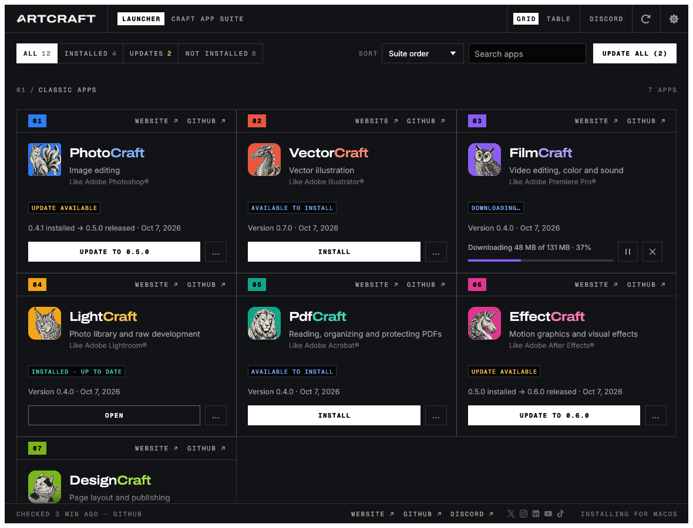

<p align="center">
  <a href="https://getartcraft.com/">
    <picture>
      <source media="(prefers-color-scheme: dark)" srcset="docs/brand/artcraft-logo-white.svg">
      
    </picture>
  </a>
</p>

<p align="center">
  
</p>

<h1 align="center">ArtCraft Launcher</h1>

<p align="center">
  <b>One place to install, update and open every app in the Craft App Suite, rebuilt in pure Rust.</b><br>
  PhotoCraft, LightCraft, FilmCraft, DesignCraft, VectorCraft, PdfCraft, EffectCraft, WordCraft,<br>
  DeckCraft, GridCraft, CADCraft, SoundCraft, FigCraft and the community app SolidCraft: the right build for your computer, kept up to date.
</p>

<p align="center">
  
  
  
  
  <br>
  <a href="https://sonarcloud.io/project/overview?id=storytold_craft-launcher"></a>
  <a href="https://coderabbit.ai"></a>
</p>

<p align="center">
  <a href="https://discord.gg/artcraft"></a>
</p>

<p align="center">
  <a href="https://github.com/storytold/craft-launcher/releases/latest"><b>Download ArtCraft Launcher</b></a> ·
  <a href="https://getartcraft.com/">ArtCraft</a> ·
  <a href="https://getartcraft.com/apps">The Craft App Suite</a>
</p>

> [!NOTE]
> **ArtCraft is a community of artists from all walks of life.** Painters, photographers,
> filmmakers, illustrators, designers, animators, hobbyists, and people who picked up a pencil
> last week. If you make things, you're one of us. **[Come say hi on Discord](https://discord.gg/artcraft).**

<p align="center">
  <a href="#what-it-does">What it does</a> ·
  <a href="#features">Features</a> ·
  <a href="#downloads">Downloads</a> ·
  <a href="#build-from-source">Build from source</a> ·
  <a href="#the-craft-app-suite">Craft App Suite</a> ·
  <a href="https://discord.gg/artcraft">Discord</a>
</p>

<p align="center">
  
</p>
<p align="center">
  <br>
  <sub>Switch between the grid and a sortable table.</sub>
</p>

## What it does

The Craft apps each ship their own builds for every platform. ArtCraft Launcher saves you from
hunting through a dozen release pages: it lists every app in the suite, shows which ones you have
and which version, installs the right build for your operating system and processor, and tells
you when an update is out. It is a small native app that can sit in your menu bar or system tray.

## Features

<table>
  <tr>
    <td width="33%" valign="top">
      <h3>📦 Install in one click</h3>
      Picks the right download for your OS and CPU (DMG, MSI, AppImage, .deb, .rpm and more), checks it against the release's SHA-256 checksums and installs it.
    </td>
    <td width="33%" valign="top">
      <h3>🔄 Stay up to date</h3>
      Checks each app's GitHub releases and updates the ones you have. A notification tells you when there's something new.
    </td>
    <td width="33%" valign="top">
      <h3>🧭 Always at hand</h3>
      Opens any Craft app from one window, or from the tray and menu-bar icon. Native egui, no Electron, no web view.
    </td>
  </tr>
</table>

The web version shows the same catalog in the browser, with the latest download for each app.

## Interface languages

The interface is in English, Brazilian Portuguese (Português (Brasil)), Czech (Čeština), French
(Français), German (Deutsch), Hungarian (Magyar), Japanese (日本語), Polish (Polski), Russian
(Русский), Simplified Chinese (简体中文) or Spanish (Español). **Auto**, the default, follows the
system or browser language; **Settings → Language** picks one and switches at once, and the choice
is kept between runs. Czech locales (`cs-CZ`, `cs_CZ.UTF-8`…) select Czech, German ones (`de-DE`,
`de-AT`, `de-CH`, `de_DE.UTF-8`…) German, French ones (`fr-FR`, `fr-CA`…) French, Hungarian ones
(`hu`, `hu-HU`, `hu_HU.UTF-8`…) Hungarian, Japanese ones (`ja`, `ja-JP`, `ja_JP.UTF-8`…) Japanese,
Polish ones (`pl`, `pl-PL`, `pl_PL.UTF-8`) Polish, Spanish ones (`es-ES`, `es-MX`, `es-419`…)
Spanish, and Portuguese ones (`pt-BR`, and `pt-PT` too, for now) Brazilian Portuguese. Simplified
Chinese locales (`zh-CN`, `zh-SG`, `zh-Hans`, and POSIX forms such as `zh_CN.UTF-8`) select
Chinese; Traditional Chinese ones don't. To try a language without changing the setting, start the
desktop app with `ARTCRAFT_LAUNCHER_LOCALE=pt-BR`, or add `?lang=ru` to the web address.

The CJK languages are drawn with the system's own CJK font (Hiragino Sans or PingFang on macOS,
Yu Gothic, Meiryo or Microsoft YaHei on Windows, Noto Sans CJK, IPA, Takao or WenQuanYi on Linux and
FreeBSD). Where the system has no font for one, and in the web version, the interface stays in
English and Settings says why. Product names and release notes stay as published; text without a
translation falls back to English.

## Where apps are installed

ArtCraft Launcher installs each app where your system normally keeps applications, using the
app's official release package, so an app installed by the launcher is the same as one you
installed by hand (and the launcher finds apps you installed yourself):

| System | Where | How |
|---|---|---|
| macOS | `/Applications/<App>.app` | Copied from the signed, notarized release DMG |
| Windows | `C:\Program Files\ArtCraft\<App>` (`Program Files (x86)` for a 32-bit build) | The release MSI, through Windows Installer, for everyone on the computer (with Start menu entry and Apps & features entry). Windows asks for administrator permission for each new install. An app already installed for your account only (`%LOCALAPPDATA%\Programs\ArtCraft\<App>`) keeps its folder and scope when updated; to move it, uninstall it and install it again |
| Linux | `/usr/bin`, `/usr/share/applications` | The release `.deb` (apt) or `.rpm` (dnf, zypper), with your system's password prompt. Without those, a Flatpak, or an AppImage in `~/Applications` |
| Linux, inside the launcher's Flatpak, with no Flatpak on the host | `~/.var/app/ai.storyteller.artcraft-launcher/data/artcraft-launcher/apps/<app>` | The release tarball, unpacked into the launcher's own folder and run inside the same sandbox, with its settings in a `home/` folder beside it. Nothing is installed on the host, and each app's configuration stays in the sandbox |
| FreeBSD | `/usr/local` | The release tree, with a password prompt (polkit); `~/.local` when polkit isn't installed |

ArtCraft Launcher keeps itself current too: when a new version is out, **Update and restart**
downloads it, verifies it, puts it where this copy is installed (the `.app`, the Windows Installer
package or portable folder, the AppImage, or the `.deb`/`.rpm`) and reopens it.

Updates use the same format an app was installed with. Every download is checked against the
release's published SHA-256 before it is installed, and a running app is never replaced.

## Updates without an administrator prompt (Windows)

On Windows the Craft Apps install for every user, into Program Files, so each update needs
administrator permission: a UAC prompt every time. The **ArtCraft Launcher Update Service** is the
opt-in way round it. An administrator installs it once, from
`artcraft-launcher-updater-<ver>-windows-{x64,arm64,x86}.msi` (Windows asks for permission for
that install). From then on:

- **Updates install in the background once an administrator turns that on.** It's one setting for
  the whole computer. In ArtCraft Launcher, **Settings → Updates → Automatically download and
  install updates** shows it, and changing it there asks for administrator permission (UAC): other
  people on the computer see it, but can't turn it off, or on, without an administrator's password.
  Turned on, the service installs the updates of the apps installed for all users as they come out
  (it checks every 6 hours), even while the launcher is closed, leaving any app that's open until
  it's closed. An administrator can also set it with `artcraft-launcher-updater set auto-update
  on|off` in an administrator terminal, when installing the service (`AUTOUPDATE=1`), or by Group
  Policy, which locks it.
- **The launcher's Update button needs no prompt.** The launcher hands the update to the service and
  shows its progress as usual. Without the service, it installs the update itself, with the prompt.
- **There's a command line**, on the `PATH`: `artcraft-launcher-updater check` looks for updates,
  `artcraft-launcher-updater update` installs them (all of them, or only the apps named:
  `artcraft-launcher-updater update photocraft wordcraft`), and `artcraft-launcher-updater status`
  shows the service's settings, its last check and how each update went. `--json` prints the result
  for scripts. `check` exits with 100 when updates are available, 0 when there are none, 1 when it
  couldn't check.

What the service will and won't do, since it runs as LocalSystem:

- It only **updates** Craft Apps an administrator already installed for all users, and only to a
  **newer** release. Installing a new app still goes through the launcher and its UAC prompt.
- It downloads only from the apps' own `storytold/<app>` GitHub releases (as the launcher does), into
  a folder in the system's own profile that users can't write to. Before running a package it checks
  the release's published SHA-256, that Windows finds the package's Authenticode signature valid and
  made by Learning Machines Inc (the Craft Apps' publisher: the certificate's whole subject,
  `CN=Learning Machines Inc, O=Learning Machines Inc, L=Atlanta, S=Georgia, C=US`, not just the
  name), and that the package is that app at that version. Community apps (SolidCraft) sign their
  own packages, so it leaves them to the launcher, which updates them with the UAC prompt.
- The launcher and the command line reach it over a loopback connection (port 47414), and believe
  only the service's own process there (as Windows reports which process holds each end), not
  another program that took the port while the service was stopped. Requests name apps by id,
  nothing else: never a path, a download link or a version. The most another program on the
  computer can do through it is start a check or a pending update sooner, or postpone one.

Settings live in `HKLM\SOFTWARE\Learning Machines LLC\ArtCraft Launcher Updater`. Give them to the
installer (`msiexec /i artcraft-launcher-updater-<ver>-windows-x64.msi AUTOUPDATE=1`, kept by later
versions) or set them by Group Policy as DWORDs under
`HKLM\SOFTWARE\Policies\Learning Machines LLC\ArtCraft Launcher Updater`, which wins:

| Setting (property / value) | Default | Meaning |
|---|---|---|
| `AUTOUPDATE` / `AutoUpdate` | 0 | 1: install updates in the background. 0: only when the launcher or the command line asks. ArtCraft Launcher's "Automatically download and install updates" shows this, and changes it with administrator permission |
| `ALLOWREQUESTS` / `AllowRequests` | 1 | Let the launcher and the command line ask for checks and updates. 0: the schedule only |
| `CHECKINTERVALHOURS` / `CheckIntervalHours` | 6 | Hours between checks (1 to 168) |
| `PRERELEASES` / `Prereleases` | 0 | 1 offers pre-releases as updates |

The service writes its log to `C:\Windows\System32\config\systemprofile\AppData\Local\ArtCraft Launcher Updater\logs\artcraft-launcher-updater.log`,
and each Windows Installer run's log beside it (`msi-<app>.log`). Uninstall it from
**Settings → Apps** like any other app; the launcher goes back to asking for permission.

The launcher writes its log to `logs/artcraft-launcher.log` in its data folder
(`~/.local/share/artcraft-launcher` on Linux, `~/Library/Application Support/ArtCraft Launcher`
on macOS, `%LOCALAPPDATA%\ArtCraft Launcher` on Windows, `ArtCraftLauncherData` beside the
portable zip's executable) and keeps the previous two runs as `artcraft-launcher.1.log` and
`artcraft-launcher.2.log`. `RUST_LOG` changes what it records (`debug`, `info,zbus=warn`, …).

## Downloads

Download the build for your computer from the [latest release](https://github.com/storytold/craft-launcher/releases/latest), or browse [all releases](https://github.com/storytold/craft-launcher/releases). Every release has a `SHA256SUMS.txt` to check the files against. `<ver>` is the version number, for example `0.1.0`.

**Windows** (10 and 11)

| File | What it is |
|---|---|
| `artcraft-launcher-<ver>-windows-x64.msi` | Installer for most PCs (Intel and AMD, 64-bit). Installs for the current user, no admin rights needed |
| `artcraft-launcher-<ver>-windows-arm64.msi` | Installer for Windows on Arm (Snapdragon and other Arm PCs) |
| `artcraft-launcher-<ver>-windows-x86.msi` | Installer for 32-bit Windows |
| `artcraft-launcher-<ver>-windows-{x64,arm64,x86}-portable.zip` | No install: unzip and run `artcraft-launcher.exe`. Keeps its settings in the folder |
| `artcraft-launcher-updater-<ver>-windows-{x64,arm64,x86}.msi` | Optional, for administrators: the [ArtCraft Launcher Update Service](#updates-without-an-administrator-prompt-windows), which installs app updates without a UAC prompt each time, and the `artcraft-launcher-updater` command line |

**macOS** (11 Big Sur or later)

| File | What it is |
|---|---|
| `artcraft-launcher-<ver>-macos-universal.dmg` | Universal app for Apple silicon and Intel Macs, signed and notarized. Drag ArtCraft Launcher to Applications |

**Linux** (x86_64 and aarch64; glibc 2.35 or newer, e.g. Ubuntu 22.04+, Debian 12+, Fedora 36+)

| File | What it is |
|---|---|
| `artcraft-launcher-<ver>-linux-{x86_64,aarch64}.AppImage` | Runs on almost any distro without installing; `chmod +x` and run. The `.AppImage.zsync` beside it lets AppImageUpdate fetch only what changed |
| `artcraft-launcher-<ver>-linux-{x86_64,aarch64}.deb` | Debian, Ubuntu, Mint, Pop!_OS: `sudo apt install ./artcraft-launcher-…deb` |
| `artcraft-launcher-<ver>-linux-{x86_64,aarch64}.rpm` | Fedora, openSUSE, RHEL: `sudo dnf install ./artcraft-launcher-…rpm` |
| `artcraft-launcher-<ver>-linux-{x86_64,aarch64}.flatpak` | Flatpak bundle: `flatpak install --user artcraft-launcher-…flatpak`. Inside the sandbox the launcher installs apps as Flatpaks on the host through `flatpak-spawn --host`; where the host has no Flatpak it falls back to each app's release tarball, unpacked and run inside the sandbox with the app's settings kept in it. Either way it can only reach the host as far as that permission allows; the AppImage, .deb and .rpm builds are the recommended way to run the launcher on Linux |
| `artcraft-launcher-<ver>-linux-{x86_64,aarch64}.tar.gz` | Plain tree (`bin/`, `share/`) for everyone else and for scripts |

RISC-V (riscv64): `artcraft-launcher-<ver>-linux-riscv64.{deb,rpm,tar.gz}`, built against Ubuntu 24.04 (needs glibc 2.39+).

The tray icon uses the StatusNotifierItem standard: KDE, Xfce, Cinnamon and most other desktops show it; on GNOME install the AppIndicator extension.

**FreeBSD** (14, x86_64)

| File | What it is |
|---|---|
| `artcraft-launcher-<ver>-freebsd-x86_64.tar.gz` | A tree laid out like `/usr/local` |

```sh
pkg install libxkbcommon wayland libX11 libXcursor libXrandr libXi libxcb mesa-libs vulkan-loader fontconfig freetype2
tar -xzf artcraft-launcher-<ver>-freebsd-x86_64.tar.gz --strip-components 1 -C /usr/local
artcraft-launcher
```

**Web (WebAssembly)**

| File | What it is |
|---|---|
| `artcraft-launcher-web-<ver>.zip` | The catalog as a static site you can host anywhere; see [`packaging/web/README.md`](packaging/web/README.md) |

## Build from source

You need a recent stable Rust (1.90 or newer). On Linux, install the windowing headers first
(Debian/Ubuntu: `sudo apt install libxkbcommon-dev libwayland-dev libx11-dev libxrandr-dev libxi-dev libgl1-mesa-dev`).

```sh
git clone https://github.com/storytold/craft-launcher
cd craft-launcher
cargo run --release -p artcraft-launcher   # the desktop app
cargo run -p artcraft-launcher-updater -- check   # the command line (the update service is Windows only)
cargo xtask ci                             # fmt, clippy, tests and the wasm check
```

The web version builds with [trunk](https://trunk-rs.github.io/trunk/):

```sh
rustup target add wasm32-unknown-unknown
cd apps/artcraft-launcher-web && trunk serve
```

### Nix (experimental)

`flake.nix` gives a dev shell (`nix develop`, then the cargo commands above) and a package:

```sh
nix run github:storytold/craft-launcher
```

On NixOS this uses the system's graphics drivers. On other distros, a Nix-built program can't load
the host's GPU drivers, so the window may fail to open. Run it through
[nixGL](https://github.com/nix-community/nixGL) instead (NVIDIA needs nixGL's matching NVIDIA
variant), or use the AppImage, `.deb` or `.rpm` release:

```sh
nix run --impure github:nix-community/nixGL -- nix run github:storytold/craft-launcher
```

### Installing your own builds

To install and update the Craft apps from checkouts on your machine instead of GitHub, clone them
next to this repo (`../photocraft`, `../wordcraft`, …) and run:

```sh
cargo xtask local sync      # git pull every app, build and package each new version into ../local-mirror
cargo xtask local serve     # serve the builds and a release feed on http://127.0.0.1:8787/
ARTCRAFT_LAUNCHER_DOWNLOAD_BASE=http://127.0.0.1:8787/ cargo run --release -p artcraft-launcher --features local-mirror
```

Run `sync` again whenever you want updates, or let the server do it: `cargo xtask local serve
--sync-every 1h` pulls and builds on that interval while it serves. An app is rebuilt when its
checkout's version isn't in the mirror yet (`--rebuild` forces it), and the launcher's next check
picks it up. Add `--every-commit` to build every new commit instead, as a dev version between
releases (`0.4.0` builds as `0.4.1-dev.<commit time>`), which the launcher offers as an update. While
`ARTCRAFT_LAUNCHER_DOWNLOAD_BASE` is set (loopback addresses only), the launcher asks only the
mirror, never GitHub. Only builds with the `local-mirror` feature read it; releases never have it. `cargo xtask local help` lists the options (`--only`, `--no-pull`, `--arch`, …).

New contributors and AI agents: start with [`AGENTS.md`](AGENTS.md). Release packaging lives in
[`packaging/`](packaging/) and [`.github/workflows/release.yml`](.github/workflows/release.yml).

> [!IMPORTANT]
> **Status:** ArtCraft Launcher is new and in early alpha. Expect rough edges, and please file
> issues (include your OS, which app you were installing and the launcher's log file) or tell us on
> [Discord](https://discord.gg/artcraft).

## The Craft App Suite

ArtCraft Launcher installs the **Craft App Suite**: free, open-source creative tools from the
[ArtCraft](https://getartcraft.com/) team, each written from scratch in Rust and each able to
stand on its own.

| | App | What it's for | Code | Learn more |
|:-:|---|---|---|---|
|  | **PhotoCraft** | Image editing: layers, masks, type and real PSD files | [GitHub](https://github.com/storytold/photocraft) | [Website](https://getartcraft.com/apps/photocraft) |
|  | **VectorCraft** | Vector illustration | [GitHub](https://github.com/storytold/vectorcraft) | [Website](https://getartcraft.com/apps/vectorcraft) |
|  | **FilmCraft** | Video editing, color and sound | [GitHub](https://github.com/storytold/filmcraft) | [Website](https://getartcraft.com/apps/filmcraft) |
|  | **LightCraft** | Photo library and raw development | [GitHub](https://github.com/storytold/lightcraft) | [Website](https://getartcraft.com/apps/lightcraft) |
|  | **PdfCraft** | Reading, organizing and protecting PDFs | [GitHub](https://github.com/storytold/pdfcraft) | [Website](https://getartcraft.com/apps/pdfcraft) |
|  | **EffectCraft** | Motion graphics and visual effects | [GitHub](https://github.com/storytold/effectcraft) | [Website](https://getartcraft.com/apps/effectcraft) |
|  | **DesignCraft** | Page layout and publishing | [GitHub](https://github.com/storytold/designcraft) | [Website](https://getartcraft.com/apps/designcraft) |
|  | **FigCraft** | Interface design and prototyping | [GitHub](https://github.com/storytold/figcraft) | [Website](https://getartcraft.com/apps/figcraft) |
|  | **WordCraft** | Word processing and documents | [GitHub](https://github.com/storytold/wordcraft) | [Website](https://getartcraft.com/apps/wordcraft) |
|  | **SoundCraft** | Audio recording and editing | [GitHub](https://github.com/storytold/soundcraft) | [Website](https://getartcraft.com/apps/soundcraft) |
|  | **DeckCraft** | Presentations and slide decks | [GitHub](https://github.com/storytold/deckcraft) | [Website](https://getartcraft.com/apps/deckcraft) |
|  | **CADCraft** | Computer-aided design | [GitHub](https://github.com/storytold/cadcraft) | [Website](https://getartcraft.com/apps/cadcraft) |
|  | **GridCraft** | Spreadsheets and data | [GitHub](https://github.com/storytold/gridcraft) | [Website](https://getartcraft.com/apps/gridcraft) |
|  | **SolidCraft** | Parametric 3D CAD by Tangency Labs (community app) | [GitHub](https://github.com/tangency-labs/solidcraft) | |

And [**ArtCraft**](https://getartcraft.com/) itself, our AI image and video studio for artists who want real control.

<br>

<p align="center">
  <a href="https://discord.gg/artcraft"></a>
</p>

<h3 align="center">Come make things with us</h3>

<p align="center">
  Our Discord is where artists of every kind hang out: people who paint, shoot, draw, cut film,
  set type, and people still figuring out what they like to make. Share what you're working on,
  ask for help, tell us what's broken, or tell us what you wish these tools could do.
  Whatever your medium and however long you've been at it, you're welcome here.
</p>

<p align="center">
  <a href="https://discord.gg/artcraft"><b>discord.gg/artcraft</b></a> ·
  <a href="https://getartcraft.com/">getartcraft.com</a> ·
  <a href="https://getartcraft.com/apps">The Craft App Suite</a> ·
  <a href="https://github.com/storytold/craft-launcher">ArtCraft Launcher</a>
</p>

---

## Thanks

The community built launchers for the Craft App Suite before we did, and ArtCraft Launcher learned a
lot from them. Thank you to their authors:

| Project | Author | What we learned from it |
|---|---|---|
| [ArtCraft Suite Updater](https://github.com/Lyraedan/ArtCraft-Suit-Updater) | [@Lyraedan](https://github.com/Lyraedan) | Noticing apps installed or removed outside the updater with a quiet background re-scan, detecting Arch and AUR installs through pacman, and a platform picker that lists the downloads for every OS |
| [craftcenter](https://github.com/avokadosauce/craftcenter) | [@avokadosauce](https://github.com/avokadosauce) | Finding the latest release without spending API quota (the `releases/latest` redirect plus `SHA256SUMS.txt`), and verifying every file |
| [CRAFTSPACE](https://github.com/emircesur/CRAFTSPACE) | [@emircesur](https://github.com/emircesur) | Adopting apps that were already installed, falling back gracefully when GitHub rate-limits, background update notifications |
| [GetCraft](https://github.com/mbirnbach/getcraft) | [@mbirnbach](https://github.com/mbirnbach) | Picking the right download for each OS and CPU, recognising Windows Installer and macOS installs, a native Rust/egui launcher |
| [CraftHub](https://github.com/CraftHubLauncher/CraftHub) | [CraftHubLauncher](https://github.com/CraftHubLauncher) | Strict checks on where downloads come from, clear rate-limit messages, never replacing an app while it runs |
| [artcraft-suite](https://github.com/erikerikerik/artcraft-suite) | [@erikerikerik](https://github.com/erikerikerik) | ETag-cached release checks and installs that recover cleanly from interruptions |
| [Craft Apps Launcher & Installer](https://github.com/ZifuM/Craft-apps-launcher-installer) | [@ZifuM](https://github.com/ZifuM) | Release-page fallbacks and starting AppImage apps with a clean environment |
| [ArtCraft Launcher](https://github.com/EricVogt93/artcraft-launcher) | [@EricVogt93](https://github.com/EricVogt93) | Desktop integration for AppImages and a careful self-update design |
| [LandingCraft](https://github.com/rallegretti/LandingCraft) | [@rallegretti](https://github.com/rallegretti) | Working with the Windows Installer directly and offering stable releases only |
| [Craft Apps Manager](https://github.com/CryptoKey98/craft-apps-manager) | [@CryptoKey98](https://github.com/CryptoKey98) | Scheduled background update checks and per-app launch options |
| [ArtCraft Hub Launcher](https://github.com/tinyplayerss/artcraft-hub-launcher) | [@tinyplayerss](https://github.com/tinyplayerss) | A friendly, one-window hub for the whole suite |
| [CraftHub](https://github.com/MegaTheLEGEND/CraftHub) | [@MegaTheLEGEND](https://github.com/MegaTheLEGEND) | Serving the apps' web builds from a self-hosted launcher |

## License and credits

ArtCraft Launcher is dual-licensed under [MIT](LICENSE-MIT) or [Apache-2.0](LICENSE-APACHE), at your option.
Copyright (c) 2026 ArtCraft Team and the ArtCraft Launcher contributors. Required notices are in [NOTICE](NOTICE).

Bundled fonts, icons, images and other assets keep their own open licenses; each one is listed
with its author, source and license in [ATTRIBUTION.md](ATTRIBUTION.md).

The app icons of the Craft apps (`assets/app-icons/`) are each app's own icon, copied unmodified
from its repository and licensed like that app (MIT OR Apache-2.0).

**The ArtCraft name, logo and "A" mark are not licensed under MIT or Apache-2.0.** They (everything
in [`docs/brand/`](docs/brand/), plus the app icon in [`assets/app-icon/`](assets/app-icon/), the
logo in the launcher's header and the "A" tray icon)
are trademarks of the ArtCraft Team and are not covered by this license. They may be used only unmodified, and only as
part of this repository and ArtCraft Launcher, under [`docs/brand/LICENSE-brand.txt`](docs/brand/LICENSE-brand.txt).
Forks and modified versions must remove them.

<p align="center">
  <a href="https://getartcraft.com/"></a><br>
  <sub>Made by the <a href="https://getartcraft.com/">ArtCraft</a> team and community.</sub>
</p>
