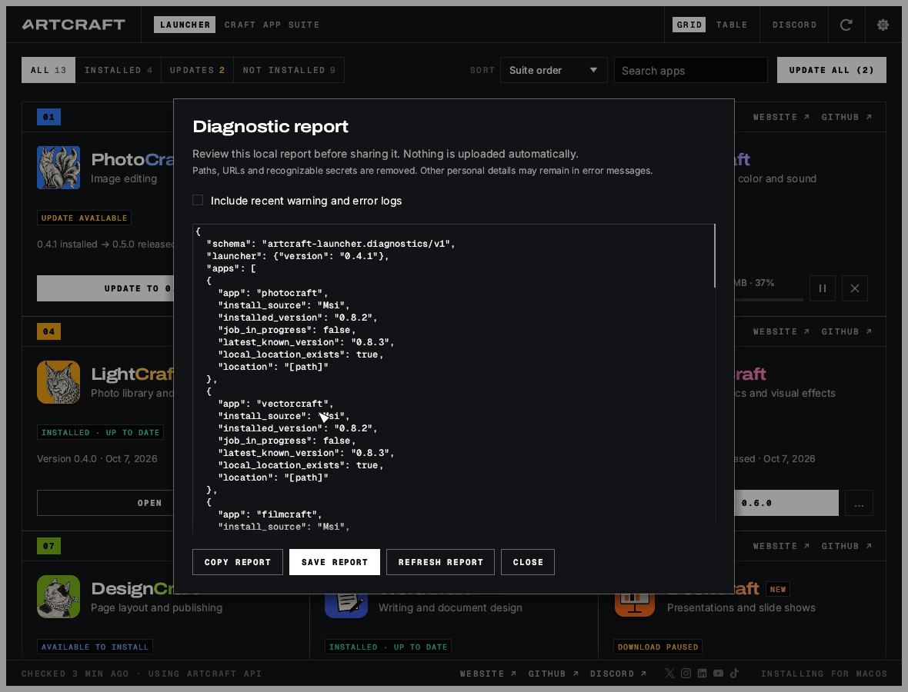
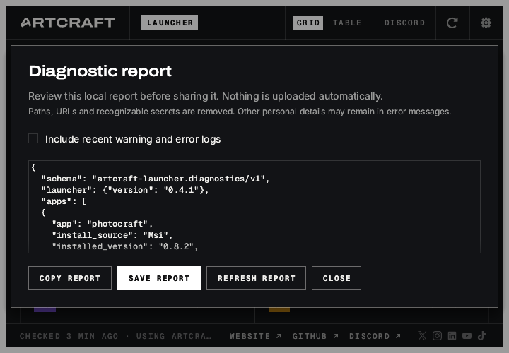

# Diagnostic reports

ArtCraft Launcher can prepare a local JSON report from **Settings → Diagnostic report**.
Review it, then copy it into an issue or save it locally. Nothing is uploaded automatically.

## Implementation plan

1. Add report commands/events to the wasm-safe backend protocol and a desktop-only settings entry.
2. Collect a bounded snapshot on a worker thread: launcher/build version, OS/architecture,
   installation mode, detection/update state, installed/latest app versions, install source,
   whether a local installation exists, active jobs, and recent launcher failures.
3. Remove filesystem paths, URLs, email addresses and messages with recognizable secret markers
   before formatting JSON. Optional warning/error log excerpts come from the current and two
   previous launcher runs, with fixed byte, line and message limits.
4. Show a selectable preview with refresh/copy/save actions. Save exactly that preview into a
   newly created report file under the launcher's data folder and offer to reveal it.
5. Test redaction, hostile/oversized logs, missing installations, unavailable logs, export failures,
   exact-preview saving, and the UI flow. Run workspace CI and wasm checks.

## Scope and privacy

The report describes the launcher's current knowledge. It does not run apps, installers,
repairs or network probes. A Flatpak installed on the host cannot be checked for file existence
from the sandbox: that check is reported as unavailable, not as a missing installation.

Log excerpts are off by default. They include only recent warning/error lines, not entire
log files, settings, document contents or environment dumps. The preview and saved JSON use
stable English field names for maintainers regardless of the interface language.

Redaction is conservative, but free-form error messages can contain personal information not
recognizable as a path, URL, email or secret. Always review the preview before sharing it.
Saving creates a distinct JSON file; previous reports and user files are not overwritten.
Reports are not automatically deleted.

Recent failures are limited to 24 per session. Optional log excerpts read at most 32 KiB from
each of the three launcher log files and keep at most eight warning/error lines per file.
Messages exceeding 1 KiB are omitted, and the complete report is capped at 128 KiB.
Non-regular log files (including symlinks) are not read. Local file checks that are unavailable
or inaccessible are `null`; only a confirmed missing path is `false`.

## Acceptance checks

The UI is checked with synthetic app data in English and German. Published screenshots use English:

- The report can be opened and closed while generation is in progress.
- Refresh invalidates the old preview; copy/save are disabled until a new report is ready.
- Toggling log excerpts invalidates the preview and generates a new one.
- Saving preserves exactly the visible report and does not regenerate it.
- Missing/unreadable logs and failed exports produce usable status messages.
- Paths, URL credentials/query values, emails and known token markers are absent from fixtures.
- Counts and input/output sizes remain bounded; malformed UTF-8 and huge log lines cannot panic.
- All complete-menu catalogs include the new UI strings; the web build still compiles.
