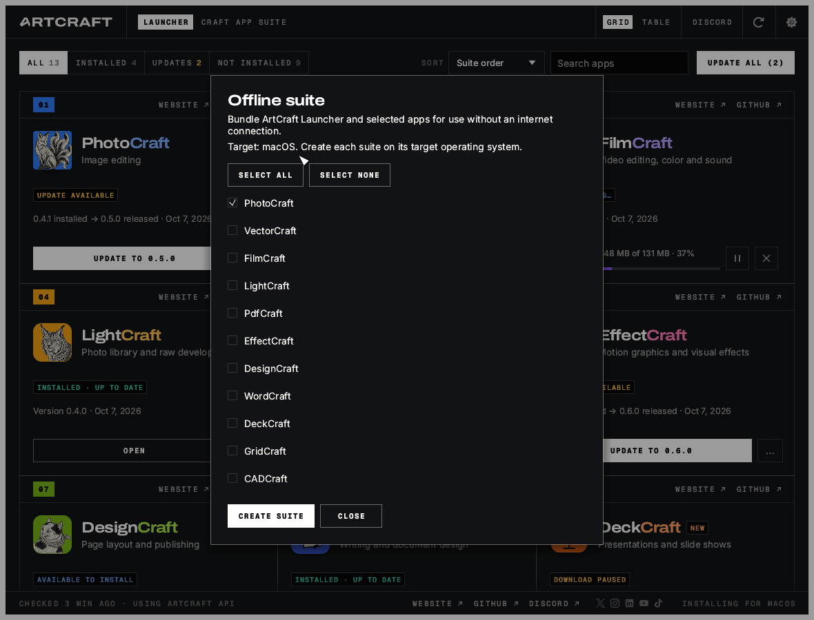

# Portable offline Craft App Suite



In **Settings → Offline suite → Create portable suite…**, select the apps and enter a
new absolute destination folder. Its parent must already exist, for example a USB drive.
The export includes the running ArtCraft Launcher build and the latest official stable
release of every selected app. All apps are selected initially; unavailable portable
releases produce an error identifying the app, so you can deselect it. Nothing is silently
omitted. Build each suite on its target operating system and CPU architecture.

| Host | App format | Start the exported launcher |
| --- | --- | --- |
| Windows | Portable ZIP, safely unpacked with Rust | `artcraft-launcher.exe` |
| Linux | AppImage | `Start ArtCraft Launcher.sh` |
| macOS | Signed `.app` copied from a read-only DMG | `ArtCraft Launcher.app` |

The exporter is independent of the regular portable-install workflow. It never invokes MSI,
a package manager, administrator prompts, or host desktop integration. Windows selection
uses the catalog's architecture fallback rules. Linux uses the current architecture; macOS
uses universal releases where available. Export from the packaged `.app` on macOS. On
Linux, an AppImage launcher exports its whole AppImage; a standalone binary exports that
binary and needs its normal host runtime dependencies. Flatpak export is refused: use a
native or AppImage launcher outside the sandbox.

An internet connection is needed **while creating** the suite. Each app must publish
`SHA256SUMS.txt`, and its portable archive must match that file's SHA-256. An API digest
alone does not suffice. The exporter accepts only built-in Craft apps and their official
`storytold` release sources. The launcher is copied from the running build, so the suite
uses the same launcher version you exported with, including development builds.

Progress and cancellation run through the desktop backend without blocking the UI.
Downloads are sequential, capped at 4 GiB each. ZIP extraction caps 50,000 entries and
8 GiB of expanded data and rejects traversal, links, Windows path aliases, duplicate names
and corrupt entries. macOS preserves bundle signatures and verifies the Craft developer's
signature. OS copy/mount operations may finish before cancellation takes effect.

Exports stage in a private folder on the destination filesystem. Existing folders are
never overwritten. Only a completed suite receives `craft-suite.json`; failure or
cancellation cleans up the job's own temporary files. An interrupted process can leave
a staging directory or an incomplete destination without that marker; delete those
leftovers manually and export into a new folder.

## Taking the suite with you

Copy or move **the entire folder**, including its manifest, apps and data directories.
The suite records relative paths and recognizes apps after a drive letter or folder changes.
The launcher remains offline: no release/feed/screenshot requests, automatic installs or
self-updates. It shows only included apps and launches those copies even if the destination
computer has other versions installed. A malformed manifest fails without falling back to
host installations. Export another suite to change versions or app selection.

Launcher settings, cache and logs stay in `ArtCraftLauncherData`. App configuration is
directed to `ArtCraftSuiteData/<app>` via Craft config overrides and OS environment paths.
No source-machine settings, documents, account tokens or caches are copied. The destination
must be writable. macOS bundles remain unmodified; their executables are launched with the
suite environment. Linux AppImages use extract-and-run to avoid requiring FUSE.

Portable storage is not a sandbox. Apps can still access files you open, OS services and
optional online features. Linux still needs a compatible graphics/audio runtime. macOS
may show its normal Gatekeeper prompt. Use the launcher to open apps, so their suite
configuration environment is applied; opening an app directly may use host configuration.

## Scripted export

The same exporter can be called without opening a window:

```text
artcraft-launcher --export-suite <new-absolute-folder> --apps photocraft,wordcraft
```

Omit `--apps` to include all catalog apps. Inside an exported suite,
`artcraft-launcher --suite-info` prints its validated manifest without network access.
Exit code zero means success; errors use a nonzero exit code. Windows executable names
include `.exe`; macOS's executable is inside the app's `Contents/MacOS` directory.
