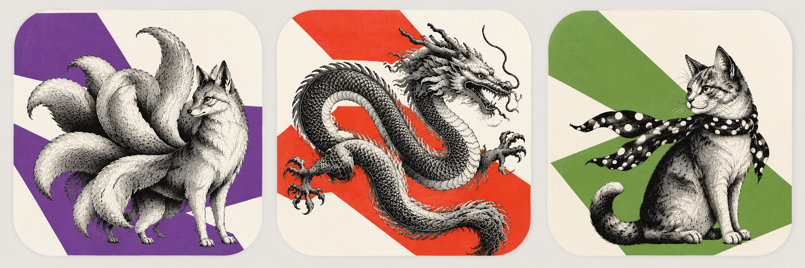
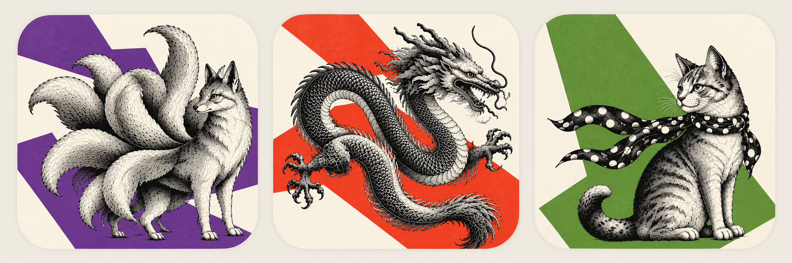

# Icon system suggestion: engraving + geometric colour fields

A visual proposal for discussion across the Craft App Suite, contributed by Andrew Collard.

The existing engraved-animal identity is distinctive. The animals do not need replacing;
the opportunity is to strengthen the figure/ground relationship and make a row of apps read
more clearly as one family. Classic natural-history book covers offer a useful reference:
detailed black engraving contrasted with large areas of simple colour and negative space.

## Original experiment

## Proposed visual grammar

- Keep the existing animal or creature assigned to each app.
- Render it as a black, old natural-history or woodcut-style engraving.
- Show the whole animal, including tails, paws and accessories.
- Give each app one identifying spot colour, drawn from a restrained Riso-like palette.
- Place simple angular geometric colour fields behind the engraving.
- Vary the composition between apps rather than repeating one horizontal split.
- Use cream or white as active negative space.
- Use no lettering or additional symbols.
- Keep engraving weight, optical scale, background tone and spacing consistent across the suite.

The direction sits between a natural-history book cover, mid-century graphic design,
paper-cut composition and a Riso print. The engraving can remain traditional while the
colour field becomes extremely simple and modern.

## Three initial examples

| App | Existing creature | Exploratory colour | Composition |
|---|---|---|---|
| PhotoCraft | Nine-tailed kitsune | Violet | Offset stepped fields echoing the tails |
| VectorCraft | Dragon | Vermilion | Diagonal fields supporting the coiled silhouette |
| DesignCraft | Cat in a polka-dot scarf | Leaf green | An asymmetric polygon balancing the upright figure |

These colours and compositions are exploratory rather than final specifications.
Other apps would retain their assigned creatures and follow the same visual grammar.

## AI-assisted exploration

This second image was generated with OpenAI's built-in image generation tool using the
original experiment as a visual reference. It illustrates a direction, not production assets
or exact reproductions of the existing animal artwork.

Prompt brief: a coordinated three-icon family preserving the kitsune, dragon and scarf cat;
black natural-history engraving on ivory; one violet, vermilion or leaf-green spot colour per
icon; distinct angular geometric backgrounds; consistent optical scale and corners; whole
animals with safe margins; no lettering or additional symbols.

## Before production

Both boards are concept illustrations. Some details still approach the tile edges, especially
the dragon's tail. A production pass should provide more clearance, simplify fine hatching,
and check each silhouette and colour field at 16, 32, 64 and 128 pixels. The full animal should
remain inside the safe area at every size. Small-size variants may need lighter detail.

Any adopted redesign should be developed in the individual app repositories, with the
launcher then copying their approved icons through its existing process. This proposal does
not change shipped icons, the ArtCraft mark, application code or packaging.

## Credits

Original experiment and proposal: Andrew Collard. AI-assisted exploration: Andrew Collard
with OpenAI image generation. Existing animal identities: ArtCraft Team and the respective
Craft app contributors; see the repository's ATTRIBUTION.md. The contribution follows this
repository's MIT OR Apache-2.0 terms; existing brand and trademark rights remain with their owners.
