# One project, twelve native workspaces

An experimental contribution to **ArtCraft Launcher**, by @durtyrobbin. This is a
source proposal for the ArtCraft team and community, not an official release.

The file stays at the center. Start in the editor you choose, paint, add vector
objects, adjust color, and carry the current artwork into a layout, document,
composition, sequence, slide, workbook, drawing reference, or soundtrack session.
Switching back retains the native editor and its work.

**Update status:** these editors are compiled together at pinned revisions. The
existing launcher's standalone app updater does not update the editors embedded
in this studio. Independently updateable modules, a stable adapter interface,
compatibility checks and rollback are future work.

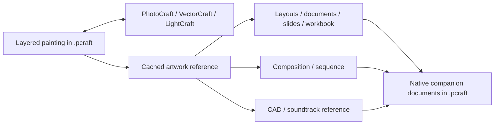

## 1. Paint, draw, and adjust the same artwork

PhotoCraft owns the layered painting. VectorCraft's editable objects are retained
as native vector data in a smart layer. Supported LightCraft global adjustments
are retained as native settings and a reversible sampled color-table layer.

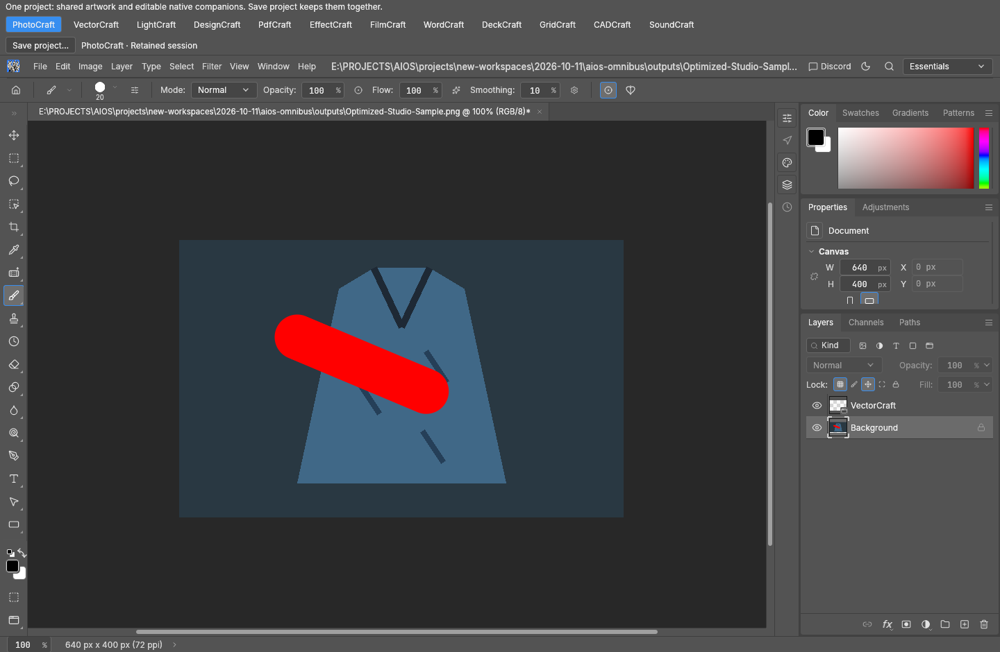

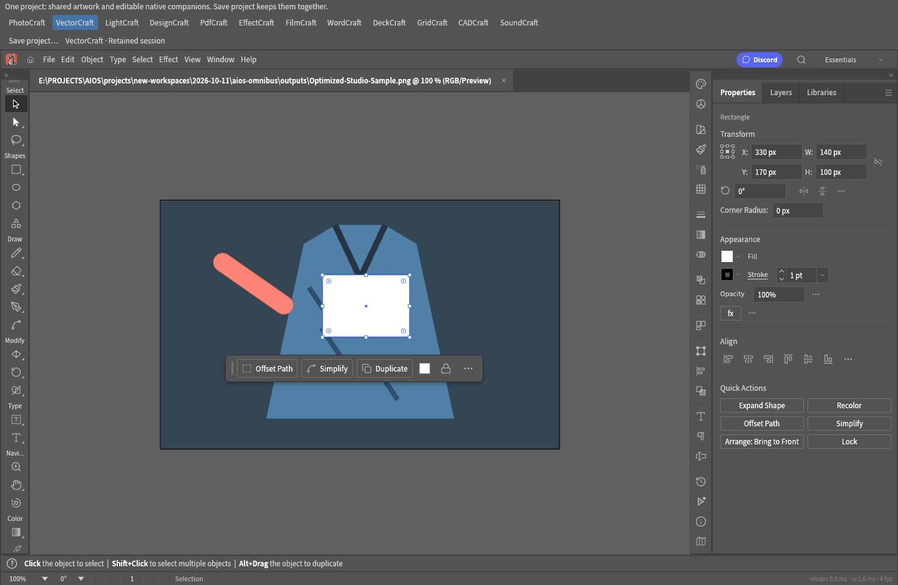

The second screenshot is from the three-editor regression: paint plus an editable
white vector rectangle plus exposure. The screenshots below are from a separate
all-app cycle test, using the same original fixture and a large red paint stroke
to make a stale preview easy to spot.

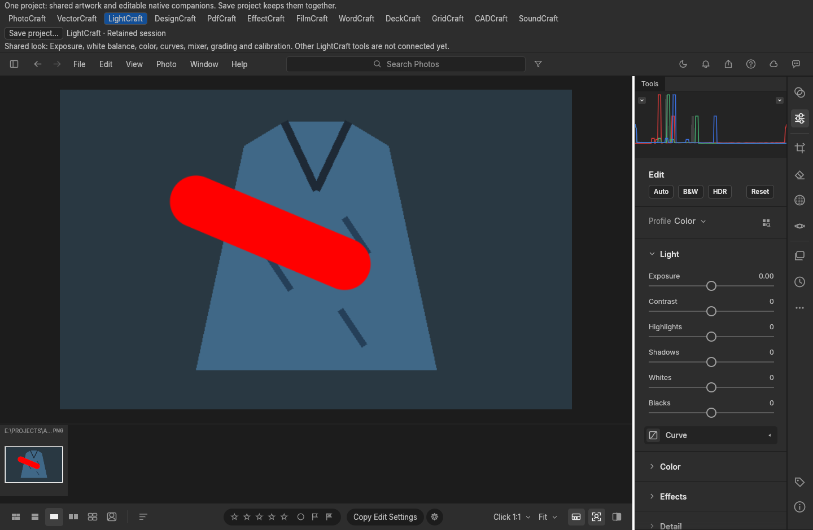

## 2. Use the artwork in native layouts and documents

The linked source image updates when you return after painting. Page objects,
captions, annotations, slides and workbook cells remain in their native documents.

| Workspace | What it receives | What remains editable |
|---|---|---|
| DesignCraft | Placed artwork image | Page layout and objects |
| PdfCraft | Artwork page | Native PDF edits, pages and annotations |
| WordCraft | Document illustration | Text and document layout |
| DeckCraft | Slide illustration | Slides, objects and text |
| GridCraft | Floating worksheet image | Cells, formulas and workbook objects |

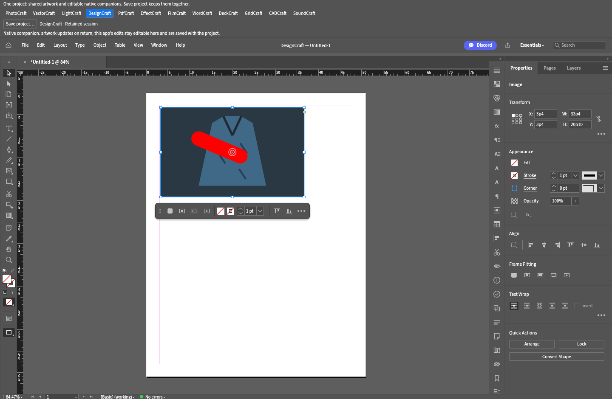

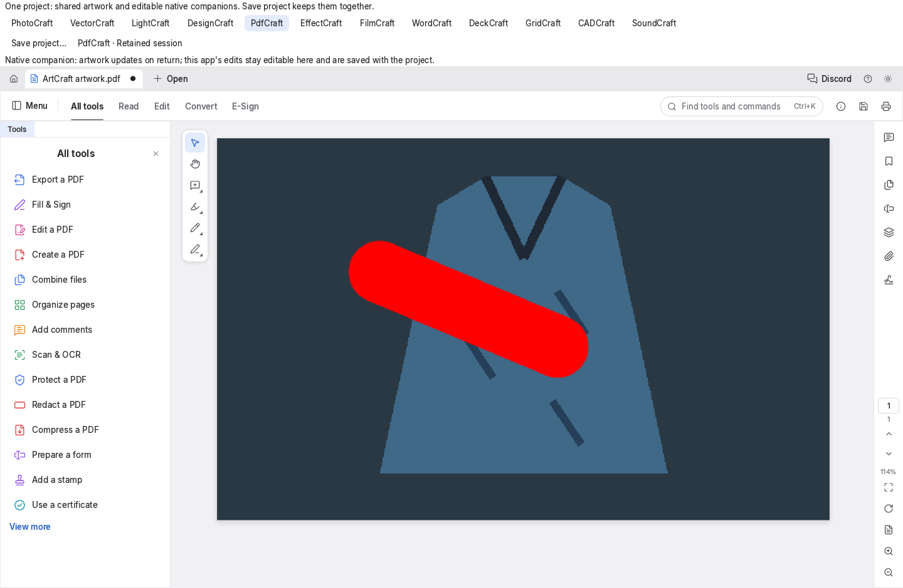

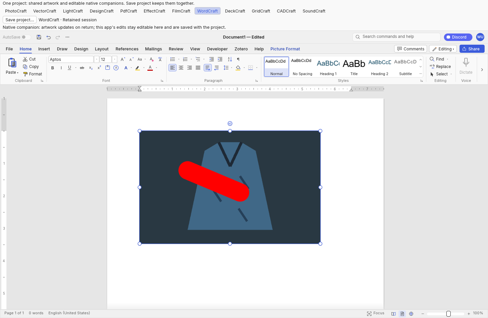

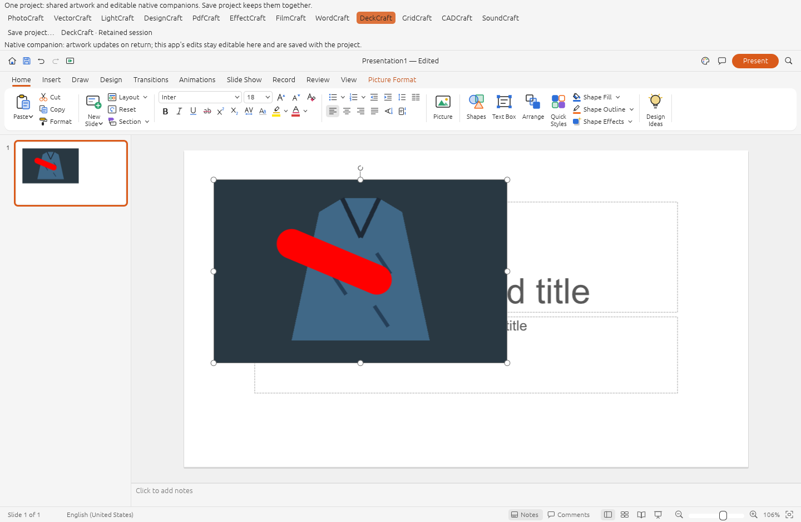

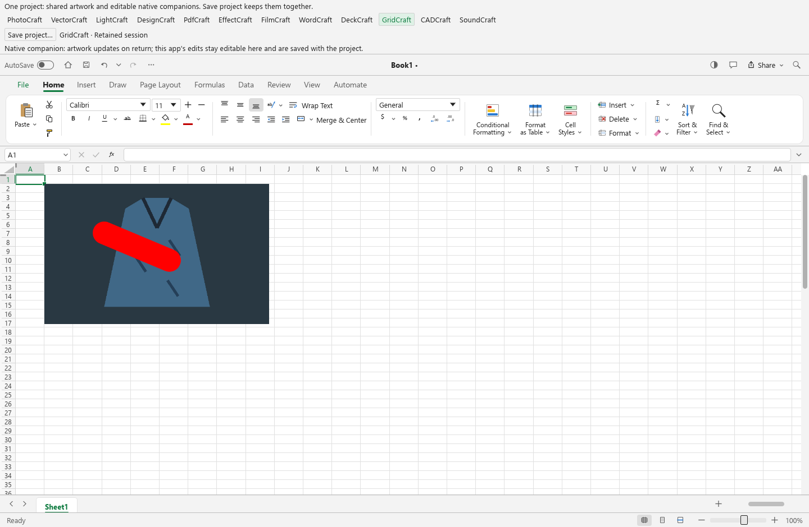

## 3. Compose and sequence

EffectCraft receives the artwork as footage in a composition. FilmCraft receives
it as a still in a sequence. Their composition and timeline edits stay native.
Changing the painting refreshes the linked source rather than recreating those
documents.

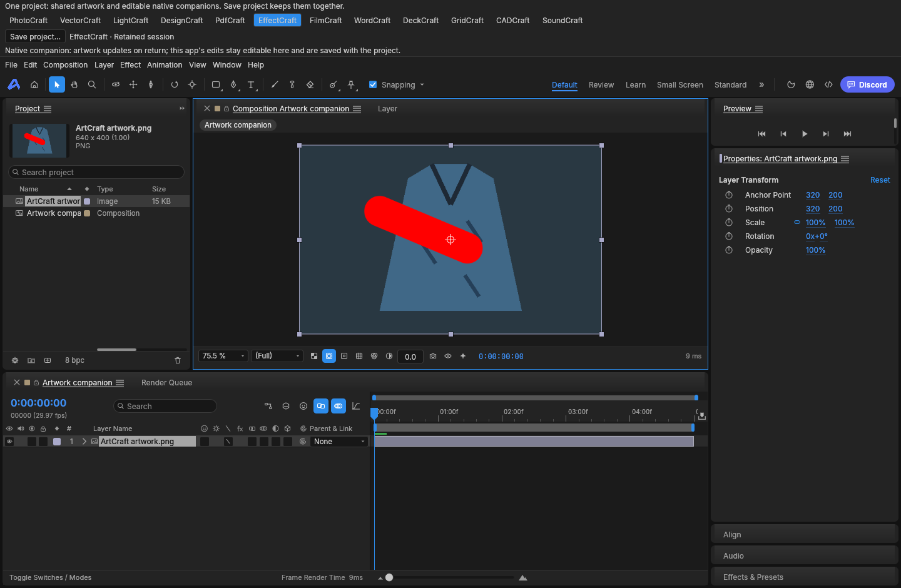

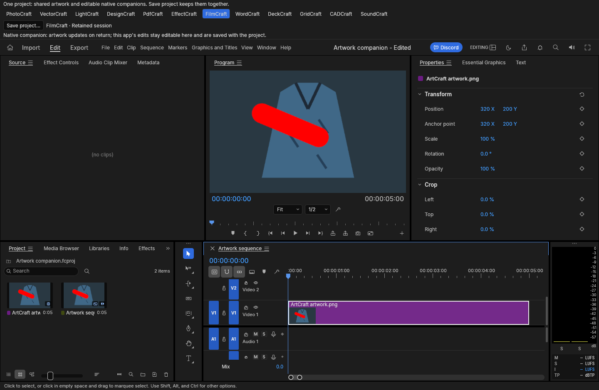

## 4. Draft or build a soundtrack beside it

CADCraft and SoundCraft show a live artwork reference beside their own workspace.
CAD starts with an aspect-ratio frame. Sound starts with two soundtrack tracks.
Geometry and audio are separate native project contents, not fabricated image
conversions. SoundCraft's live playback/recording device is not connected by this
test host; track/clip editing and offline export are the current scope.

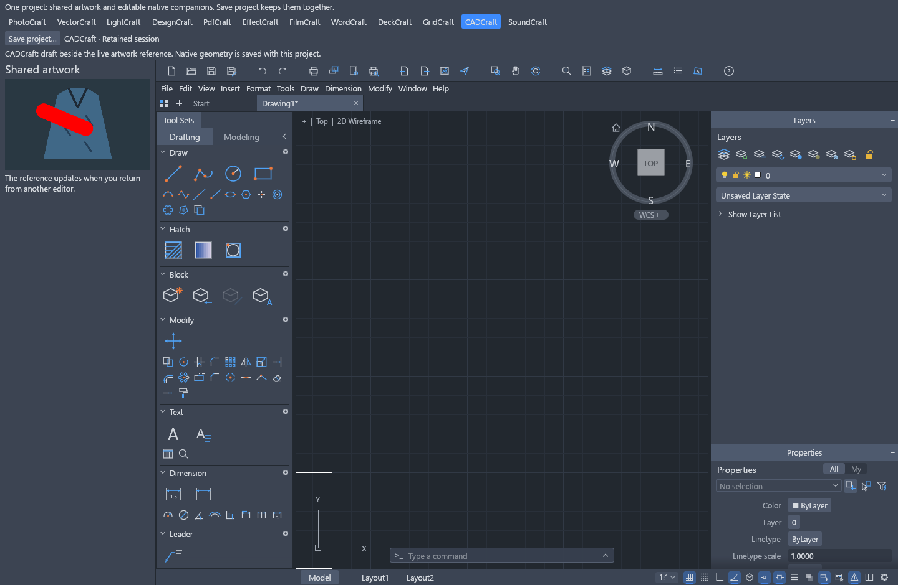

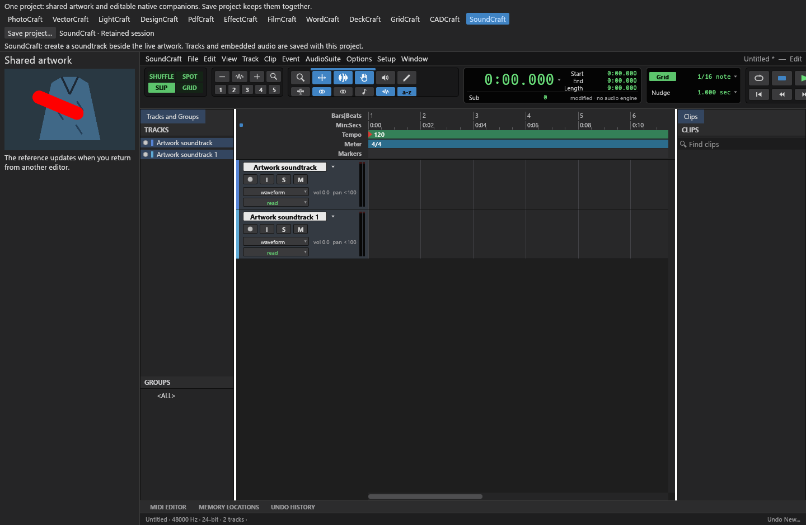

## 5. Save the project, then return to each editor

Finish any current text, cell or tool edit, then use **Save project** in the top
ArtCraft bar. Save as `.pcraft`. This keeps the shared painting, native vector
data, LightCraft settings and opened native companion documents together.

Reopen the project with the command below and choose an editor. The companion's
document is restored on first opening; later switches retain its running session.
An editor's own Save/Export applies only to that editor. JPEG/PNG do not preserve
the companion archive. The nine companion apps' edits do **not** automatically
become PhotoCraft layers.

## Build and try it

The tested platform is Windows x64 with MSVC and a DirectX 12 GPU. Install Git,
Python 3.9+, stable Rust (at least the manifests' required version) and the Visual
Studio C++ build tools. These scripts are source setup utilities; the application
and UI remain native Rust. Other platforms have not been qualified for this host.

In a fresh directory with room for the suite sources and Rust build cache:

```powershell
git clone --branch shared-document-studio https://github.com/durtyrobbin/craft-launcher.git craft-launcher
cd craft-launcher
python scripts/prepare-studio.py
cargo build --locked -p artcraft-launcher --features studio-suite --all-targets -j 2
$env:PDFCRAFT_SYSTEM_FONTS = '0'
.\target\debug\artcraft-launcher.exe --suite-cycle-test .\docs\shared-studio\sample.png
```

Use `--suite-cycle-test 'path\your-project.pcraft'` to reopen a saved project.
The initial screen lets you select the first editor. The source manifest pins all
twelve sibling repositories, including the four small adapter forks. The setup
script refuses to reset an existing checkout or overwrite local changes.

To repeat the verification:

```powershell
python scripts/prepare-studio.py --check
cargo test --locked --workspace --features studio-suite -j 2 -- --test-threads=1
cargo clippy --locked --workspace --features studio-suite --all-targets -j 2 -- -D warnings
cargo xtask wasm
$env:ARTCRAFT_SUITE_FIXTURE = (Resolve-Path docs/shared-studio/sample.png).Path
$env:ARTCRAFT_SUITE_EVIDENCE = Join-Path $PWD 'target/studio-evidence'
New-Item -ItemType Directory -Force $env:ARTCRAFT_SUITE_EVIDENCE | Out-Null
cargo test --locked -p artcraft-launcher --features studio-suite shared_three_editors_cycle_save_and_reopen -- --ignored --nocapture --test-threads=1
cargo test --locked -p artcraft-launcher --features studio-suite every_native_app_opens_and_retains_its_session -- --ignored --nocapture --test-threads=1
```

The rendered tests require a working GPU. The normal workspace tests do not run
these ignored rendering cases. The test evidence reports 231 workspace passes,
nine native companion save/reopen checks in one regression, the three-editor
regression, and 36 rendered passes: cold open, changed artwork, retained return.
See [the recorded results](results.txt) and [machine-readable measurements](measurements.json).
These are local test results, not a claim that upstream CI or every native app's
standalone test suite is green.
Additional pre-publication checks for the touched GridCraft and CADCraft adapters
are recorded in [publication-checks.txt](publication-checks.txt).

## Limits worth testing and improving

- The common artwork reference is an internal revision-cached PNG, up to four
  megapixels. No manual transfer is needed, but this is not a zero-copy universal
  renderer or a replacement of every app's canvas.
- Only Photo/Vector/Light currently contribute back to the common painting.
  Companion output round trips and a unified procedural history are future work.
- One companion document per editor; additional native tabs must be saved or
  closed before the shared project can be saved. The archive is capped at 128 MiB.
- Native undo works during the session. Reopening restores documents, not undo
  history. There is no global undo across all companion apps.
- Additional imported media can remain linked to external files. Keep them with
  the project. This prototype is not a complete portable asset collector.
- Light uses an approximate 33-cubed LUT for supported global tone/color changes.
  Unsupported edits block handoff until undone. Input currently needs opaque,
  unprofiled RGB 8/16-bit data. Full RAW/HDR/EXR, crop and mask adapters are pending.
- Grid refuses to archive imported unmodeled preserved parts rather than silently
  dropping them. CAD stores drawings using its native DXF serializer; DWG support
  is disabled in this host. Native format fidelity limits still apply.
- EffectCraft's first opening took about 40 seconds on the test machine. Returning
  to retained sessions was much faster. CPU handoff timings are **not** end-to-end
  display latency. The optional Chinese/Japanese font pack was absent.
- This branch requires sibling source checkouts even for dependency resolution.
  Extracting the shared canvas contract and decoupling default launcher builds
  are integration work before merge. Release/installer workflows are not adapted
  to this experiment; do not use this branch to cut an official release.

## Useful community feedback

Try an edit, switch away, switch back, save, reopen, and verify the edit remains
editable. Report the app, exact steps, source revisions, whether this was a first
opening or retained return, and a synthetic example file where possible. Especially
useful areas are update-safe adapters, companion-to-artwork output, richer color
management, asset portability, large documents and first-open performance.

All pictorials are unmodified captures of the native test harness, not mockups.
The sample artwork was generated for this experiment. Credits and licenses are in
[ATTRIBUTION.md](../../ATTRIBUTION.md); the upstream ArtCraft marks remain unchanged
for this contribution proposal and are not relicensed by it.
